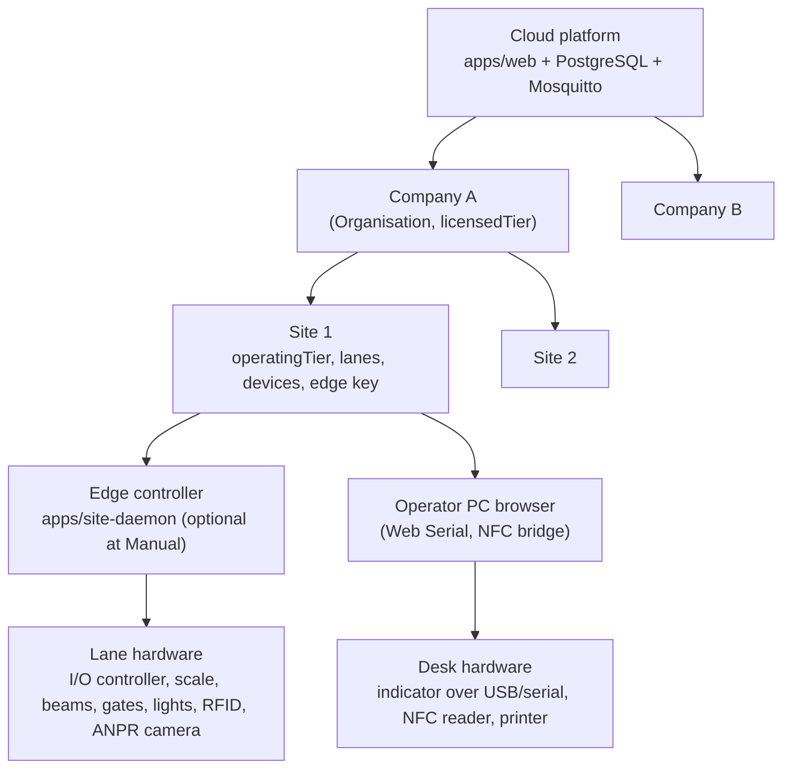
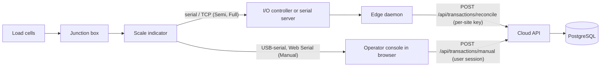
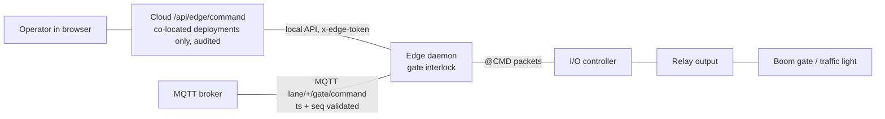

# Architecture

This document describes how the platform is built today. Where a part is planned or has not been tested with physical equipment, it says so.

## 1. Components at a glance

| Layer | Component | Path | Technology |
|---|---|---|---|
| Cloud | Web platform (UI and API) | `apps/web` | Next.js 15 (App Router), React 19, NextAuth v5 (credentials, JWT) |
| Cloud | Database schema, migrations, seeds, RBAC catalogue | `packages/database` | Prisma 6, PostgreSQL 16 |
| Cloud | MQTT broker | `mosquitto/` | Eclipse Mosquitto 2 |
| Cloud | Shared types and MQTT topic helpers | `packages/shared-types`, `packages/mqtt-topics` | TypeScript |
| Edge | Site daemon (one per site) | `apps/site-daemon` | Python 3.11, FastAPI, SQLite, paho-mqtt, pyserial |
| Edge | Hardware simulator (test only) | `apps/hardware-simulator` | Python, emits the I/O controller wire protocol over TCP |
| Edge | I/O controller firmware (prototype) | `apps/firmware-pic18` | C (XC8) for PIC18F45K22 |
| Operator PC | Web Serial scale reader | `apps/web/src/lib/serial-reader.ts` | Browser Web Serial API (Chrome or Edge) |
| Operator PC | Local NFC bridge | `tools/nfc-bridge` | Node.js, node-hid, listens on 127.0.0.1:7777 |

## 2. Logical hierarchy



The same text as a plain tree:

```
Cloud (one deployment)
└── Company (Organisation, type MINING_COMPANY, licensedTier)
    └── Site (operatingTier, featureOverrides, edge key hash)
        ├── Lane 1..n (laneNumber)
        ├── HardwareDevice rows (catalogue-driven configuration)
        ├── Edge controller (site daemon) ── drives lane hardware
        └── Operator PC browser ──────────── reads desk hardware (Manual / Semi)
```

Transporters (hauliers) are separate organisations (type `HAULIER`) linked to mining companies; they see only their own bookings, vehicles and waybills.

## 3. Cloud

### 3.1 Web platform (`apps/web`)

- Runs on port 3010 in development (`npm run dev:web`) and on port 3000 inside the container (published as 3010 by `docker-compose.yml`).
- Server-rendered pages under `src/app/` and JSON API routes under `src/app/api/`. Every API response uses `{ success, data, error }`.
- Authentication: NextAuth credentials provider with JWT sessions (8 hours). See `docs/SECURITY.md`.
- The container entrypoint runs `prisma migrate deploy` and then `next start` (`apps/web/Dockerfile`).
- Health probe: `GET /api/health` returns 200 when the database answers `SELECT 1`, otherwise 503.

### 3.2 Database (`packages/database`)

- `schema.prisma` uses `DATABASE_URL` (pooled) and `DIRECT_URL` (direct, for migrations).
- Migrations live in `packages/database/migrations/`. `seed.ts` creates the RBAC catalogue and the platform super admin. `seed-demo.ts` creates a training data set and refuses to run against a database whose name does not contain `demo`.

### 3.3 MQTT broker

- Development: `mosquitto/config/mosquitto.conf`, anonymous, bound to 127.0.0.1 by compose.
- Production: `mosquitto/config/mosquitto.prod.conf` with TLS on 8883, a password file and per-site ACLs (`mosquitto/config/acl.example`).
- Topic tree: `tenant/{organisationId}/site/{siteId}/...` with lane topics under `lane/{laneNumber}/...`. See `mosquitto/README.md`.

### 3.4 What "real time" means today

- Dashboards poll. The hardware health page refreshes every 15 seconds; the operator console polls its queue and, when configured, the co-located edge.
- Edge controllers report to the cloud with an HTTPS heartbeat (`POST /api/edge/heartbeat`, every 30 seconds by default).
- The web app publishes to MQTT (`lib/mqtt.ts`, used only for `dashboard/{userId}/notifications`) but **has no MQTT subscriber**. Telemetry the edge publishes to MQTT is not consumed by the cloud application today.
- `components/providers.tsx` opens a Socket.IO client connection, but no Socket.IO server is started anywhere in the repository, so it never receives messages.

## 4. Multi-tenancy model

Two layers decide what a signed-in user can see.

### 4.1 Company scope (`apps/web/src/lib/access.ts`)

- `isPlatformSuperAdmin(user)` is true only when `platformRole = PLATFORM_SUPER_ADMIN`.
- `resolveScope` / `userScope` / `userSiteScope` return an unscoped filter for the super admin and `{ organisationId }` (or `{ site: { organisationId } }`) for everyone else.
- A non-super-admin without a company throws `TenantScopeError`, which `withScopeErrors` turns into HTTP 403. The scope fails closed; it never degrades to "all".
- `transporterScope` limits transporters to bookings where `transporterOrganisationId` is their own organisation.

### 4.2 Site scope (`apps/web/src/lib/site-access.ts`)

`loadAccessContext(user)` returns one of three contexts:

| Context | Who | Sees |
|---|---|---|
| `platform` | Platform super admin | Every company and site |
| `company` | ADMIN, OPERATOR or SECURITY with **no** `UserSiteAccess` rows | Every site of their company |
| `sites` | ADMIN, OPERATOR or SECURITY with one or more `UserSiteAccess` rows | Only those sites |

An ADMIN in the `sites` context is shown as **Site Admin**; an ADMIN in the `company` context is a **Company Admin** (`roleLabel`). Company-wide administration (users, roles, site access, password resets) goes through `requireCompanyAdmin()` in `lib/api.ts`, which refuses Site Admins so they cannot widen their own access.

Helpers `siteWhere`, `viaSiteWhere`, `contextAllowsSite` and `canAccessSite` are used by routes and pages to filter queries and to return 404 (not 403) for records outside the caller's scope.

## 5. Tier model

`apps/web/src/lib/tiers.ts` defines three tiers: Manual, Semi-Automatic and Fully Automatic. A tier never forks code; it only decides which capabilities a site may use:

```
effective capabilities = site tier ∩ company licence (Organisation.licensedTier)
                         ∩ installed, active, not-in-maintenance hardware
                         ∩ per-site overrides (featureOverrides.disabled)
```

`resolveSiteCapabilities()` returns the effective tier, per-capability state, the manual-entry policy, whether a card is required, and readiness issues (blockers and warnings). A site cannot be activated while it has a blocker. Details are in `docs/TIERS.md`.

## 6. Edge

### 6.1 Site daemon (`apps/site-daemon`)

One daemon runs per site on an on-site PC. For a `DUAL_ENTRY_EXIT` site it runs one independent lane runtime per configured lane, sharing one SQLite ledger, one MQTT client and one sync worker.

| Part | File | What it does |
|---|---|---|
| Configuration and start-up policy | `config.py` | Loads YAML, applies `WB_*` environment overrides, refuses unsafe production starts |
| HTTP API | `daemon.py` | FastAPI on `WB_HTTP_HOST:WB_HTTP_PORT` (default 0.0.0.0:8000) |
| I/O controller protocol | `protocol.py` | Parses telemetry frames and builds command packets |
| Weighing state machine | `state_machine.py` | IDLE → VEHICLE_APPROACHING → POSITIONING → STABILISING → CAPTURED → PROCESSING → AWAITING_DRIVER_DECISION → COMPLETE, plus FAULT and MANUAL_MODE |
| Gate interlock | `gate_safety.py` | Every gate open passes through one interlock; auto-close waits for beams to clear |
| Local ledger | `database.py`, `sqlite_schema.sql` | SQLite transactions with a SHA-256 hash chain, sync queue, booking cache, incidents, session recovery |
| Cloud sync | `sync_worker.py` | Uploads queued transactions and incidents with idempotency keys and exponential backoff |
| Cloud client | `cloud_client.py` | Sends the per-site key in `x-site-api-key` |
| Heartbeat | `heartbeat.py` | Builds per-device health reports keyed by cloud device keys |
| MQTT | `mqtt_client.py`, `topics.py` | Publishes telemetry under the tenant prefix; subscribes to `lane/+/gate/command` |
| ANPR | `anpr.py` | EasyOCR plate recognition; only present in images built with `INSTALL_ANPR=true` |

### 6.2 I/O controller wire protocol

The daemon talks to one I/O controller per lane over serial (`/dev/ttyUSB0`, 115200 baud by default) or TCP. The format is ASCII:

```
Telemetry (controller → edge):  #WT:054320;P1:1;P2:1;RF:DRV00421;ST:STABLE$
Command   (edge → controller):  @CMD:GATE_OPEN;TGT:ENTRY$
                                @CMD:LIGHT;TGT:EXIT;VAL:GREEN$
                                @CMD:BUZZER;VAL:ON$
```

Allowed actions are `GATE_OPEN`, `GATE_CLOSE`, `LIGHT`, `BUZZER`; targets `ENTRY`/`EXIT`; values `RED`, `GREEN`, `ON`, `OFF`.

### 6.3 Hardware simulator (`apps/hardware-simulator`)

Emits the same telemetry frames on TCP 7001 and accepts JSON control commands on TCP 7002 (`scenarios.py` drives complete weighments). A daemon pointed at it must declare `simulated: true`; a production daemon then refuses to start unless `WB_ALLOW_SIMULATION=true`.

### 6.4 PIC18 firmware (`apps/firmware-pic18`)

Prototype firmware for a PIC18F45K22: EUSART1 to the edge (115200 8-N-1), EUSART2 to an ASCII RFID reader (9600), beams on RD0/RD1, relays and lights on RB0–RB6. It boots with both gates closed and both lights red and only applies explicit commands. Limitations stated in its README and code:

- The on-chip 10-bit ADC scale input is a bench prototype, not legal-for-trade.
- The hardware watchdog is disabled (`WDTEN = OFF`) and there is **no communication watchdog**: the firmware does not return outputs to a safe state if the edge goes silent. The cloud setting "Watchdog (seconds)" is recorded but not enforced.
- Not physically validated as part of this release.

## 7. Browser-driven hardware (Manual and Semi-Automatic desks)

- **Scale indicator over Web Serial.** The operator console (`/operator`) opens the indicator's USB-serial port in Chrome or Edge, auto-detects baud and framing, and parses Mettler Toledo continuous, MT-SICS and generic ASCII weight lines (`lib/serial-reader.ts`). While its tab is visible, the console reports scale health to `POST /api/sites/{id}/hardware/status` every 30 seconds so Manual sites without an edge still show honest status. (The endpoint also accepts NFC reader reports; the console does not send them yet.) The Mettler Toledo path was physically validated by the team earlier (see git history); it was not re-tested for this release.
- **NFC reader via the local bridge.** `tools/nfc-bridge` reads card UIDs from a USB HID reader and serves them on `http://127.0.0.1:7777`. The browser calls the app's own `GET /api/nfc/uid`, and the **Next.js server** forwards to `NFC_BRIDGE_URL` (default `http://127.0.0.1:7777`). This works when the web server and the bridge run on the same machine (or `NFC_BRIDGE_URL` can reach the bridge). A cloud-hosted server cannot reach a bridge on an operator's PC.

## 8. Data flows

### 8.1 Weight



On automated lanes the edge captures a stable gross weight (rolling window, default 3 seconds within 20 kg), writes the transaction to SQLite with its hash-chain link, and queues it for reconciliation. On browser-driven desks the operator captures the weight (from the indicator or typed, subject to the tier's typed-weight policy) and the cloud writes the transaction directly.

Note: in the built-in Semi-Automatic and Fully Automatic templates the scale protocol is `PIC_CONTROLLER`, meaning the weight arrives inside the I/O controller's telemetry frame. The edge has no separate indicator-protocol parser.

### 8.2 Card identification (RFID / NFC)

```
RFID reader ── serial ──> I/O controller (EUSART2) ── RF:<tag> in telemetry ──> edge state machine
NFC reader  ── USB HID ─> tools/nfc-bridge (127.0.0.1:7777) ──> /api/nfc/uid ──> browser form
```

On an automated lane the edge compares the tag in telemetry with the booking's `driver_rfid` and fails closed: a booking without a registered card, or a different card, closes the entry gate, sounds the buzzer and raises a `DRIVER_MISMATCH` incident. At the operator desk the NFC bridge fills tag fields (fleet, RFID screens, device test); it does not authorise a weighment by itself.

### 8.3 Number plate (ANPR)

```
ANPR camera ── still image / OpenCV source ──> edge anpr.py (EasyOCR) ──> GET /api/bookings/active?plate=
                                                                         └─> local booking cache when offline
```

When beam P1 is broken on an idle lane and ANPR is available, the edge captures a burst of frames, picks the most frequent normalised plate, and looks up an active booking. No match raises `UNAUTHORISED_ACCESS` and keeps the entry gate closed. ANPR packages are only installed in images built with `INSTALL_ANPR=true`; otherwise the camera is reported OFFLINE in heartbeats. Live RTSP stream processing is not implemented; the engine opens the source per capture. Not physically validated with a real camera.

### 8.4 Gates and lights



- **The browser never drives gates directly.** It has no route to the relays.
- Operator gate and light commands go to `POST /api/edge/command`, which requires a reason (at least 10 characters), writes a `HARDWARE_COMMAND` audit entry, and forwards to the edge's local API with the edge's local token. This proxy exists only when the web server is configured with `SITE_DAEMON_URL` and `SITE_DAEMON_SITE_CODE` (a web server on the same LAN as one edge). A remote cloud deployment has no command path to edges today.
- The edge also accepts gate commands on MQTT `.../lane/{n}/gate/command`, validated for schema, known lane, timestamp within 30 seconds and a never-reused `seq`. No cloud component publishes these commands yet.
- Whatever the source, every open goes through the edge interlock (`gate_safety.py`). See `docs/EDGE_DEPLOYMENT.md`.

### 8.5 Offline operation and reconciliation

```
Edge SQLite ledger ── sync_queue ──> POST /api/transactions/reconcile (idempotency-key = edge transaction id)
                                  └─> POST /api/incidents
Edge ── GET /api/transactions/chain-head?site= ──> bootstraps the local chain from the cloud head
Edge ── GET /api/edge/config (every 300 s) ──────> identity, lanes, devices, MQTT prefix
Edge ── POST /api/edge/heartbeat (every 30 s) ───> edge status and per-device health
```

The cloud recomputes the integrity hash and rejects out-of-sequence or mismatched records with HTTP 409 (`HASH_CHAIN_MISMATCH`, `SITE_MISMATCH`, `BOOKING_IDENTITY_MISMATCH`, ...). A 409 that is not a confirmed duplicate stays queued and raises a CRITICAL incident at the edge.

## 9. Validation status

| Path | Status |
|---|---|
| Web unit tests (`npm test` in `apps/web`) | 111 passing |
| Edge tests (`pytest` in `apps/site-daemon`) | 89 passing |
| HTTP persona checks against a running demo (`scripts/e2e-personas.mjs`) | 28 of 28 passing |
| Edge daemon + hardware simulator against a running cloud with a per-site key | One unattended Fully Automatic weighment reconciled into the cloud hash chain (simulated hardware) |
| Mettler Toledo indicator over Web Serial | Physically validated earlier by the team; not re-tested in this release |
| Physical gates, beams, RFID readers, ANPR cameras, PLCs, printers, PIC18 board | **Not physically validated** |
